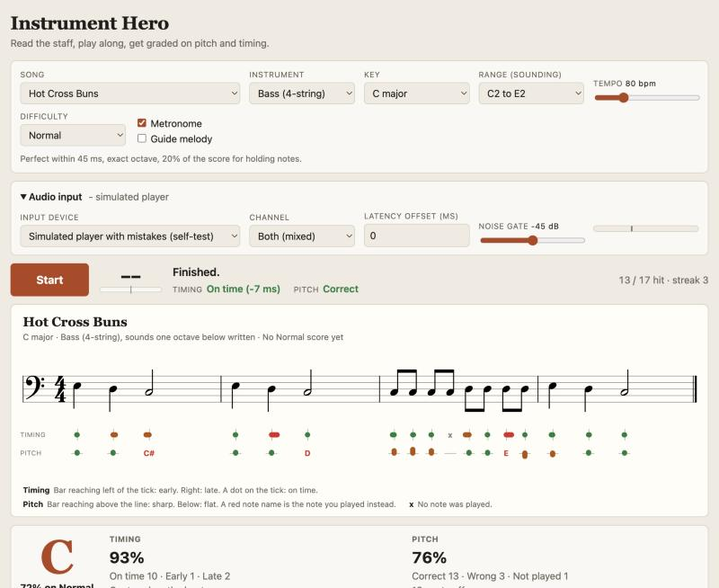

# Instrument Hero

Learn an instrument by playing along to sheet music, with the instant feedback
of a rhythm game. A cursor sweeps across standard notation in time with a
metronome; the app listens to your instrument and tells you, note by note, how
your timing and your pitch were.



It runs entirely in the browser. Nothing you play leaves your computer, and
there is no account or server-side storage.

## Features

- **Standard notation.** Real staff, clef, key signature, and time signature,
  so you practice reading as well as playing.
- **Arpeggio exercises** through the chord progressions standards are built
  on: ii-V-I in major and minor, the A sections of Autumn Leaves and rhythm
  changes, jazz blues, and minor blues. The first chord starts on the lowest
  root on your instrument, each later chord on the root closest to the one
  before (Eb to E is a half step up), and climbs 1-3-5-7 (a chord held for two bars comes back
  down 8-7-5-3; two chords in a bar get root and third each), with chord
  symbols above the staff.
- **Seventeen tunes in collections** (warm-ups, nursery rhymes, classical
  and holiday, jazz): Twinkle Twinkle Little Star, Mary Had a Little Lamb,
  Frere Jacques, Ode to Joy, Row Row Row Your Boat (in 6/8), a scale
  warm-up, and more. The jazz collection has a 12-bar jazz blues walking
  bass line and four traditional tunes: When the Saints Go Marching In,
  Down by the Riverside, Careless Love, and Just a Closer Walk with Thee.
- **The keys each song is usually played in**, two to five per song, with
  correct spelling of every note: C, G, F, and D for the beginner tunes; F,
  Bb, and C for the jazz tunes; the usual jazz keys for the arpeggio
  exercises, named as minor keys where the progression is minor. A song
  opens in its most common key.
- **Guitar and 4-string bass.** Each song is placed in an
  octave that fits the instrument, and you can choose another when more than
  one fits. Guitar and bass are written an octave above where they sound, as
  in published music.
- **Tempo from 30 to 240 bpm**, set with a slider or typed in exactly, plus
  metronome, count-in, and an optional guide melody.
- **Separate timing and pitch feedback** for every note, right under the
  staff, plus a summary that tells you which of the two to work on.
- **Three difficulty levels** that change how strictly you are scored.
- **Works with an audio interface**: choose the device and the input channel,
  watch the level meter, set a noise gate. A microphone works too.
- **Two modes.** Free play leaves every setting open. Competition fixes the
  key, range, and metronome, offers three tempos, and keeps a top 10 of named
  scores for each song.
- **Scores kept in your browser**: a personal best per song, instrument, and
  difficulty in free play, and the high-score tables in competition.

## Quick start

You need [Docker](https://docs.docker.com/get-docker/) and a Chromium-based
browser (Chrome or Edge).

```bash
git clone https://github.com/tipakorn-greigarn/instrument-hero.git
cd instrument-hero
docker compose up -d --build app
```

Open http://localhost:8080.

Browsers only allow audio input on a secure page. `localhost` counts as
secure; to use the app from another machine, serve it over HTTPS.

## Playing

1. Plug your instrument into the audio interface (or sit near the microphone).
2. Open **Audio input**, press **Connect input**, and allow microphone access.
   Pick your interface as the input device, then the channel the instrument is
   on: Input 1 is left, Input 2 is right.
3. Play a note. The level meter should move well past the gate marker, and the
   note name should appear next to the Start button. Lower the noise gate if
   quiet notes are ignored; raise it if hum registers as notes.
4. Choose **Free play** or **Competition** (see below), then a song,
   instrument, and difficulty. In free play you also choose the key, range,
   and tempo.
5. Press **Start** (or the space bar). After one bar of count-in clicks, play
   each note as the cursor reaches it.

Not sure what to expect? Choose **Simulated player with mistakes** as the
input device and press Start to watch a run with typical errors.

If you play through a microphone rather than a direct input, use headphones
for the metronome and guide melody so the app does not hear its own output.

## Reading the feedback

Two lanes under each staff show one marker per note.

| Lane | Marker | Meaning |
| --- | --- | --- |
| Timing | Dot on the tick | On time |
| Timing | Bar reaching left of the tick | Early; the longer the bar, the earlier |
| Timing | Bar reaching right of the tick | Late |
| Timing | x | No note was played |
| Pitch | Dot on the line | Right note, in tune |
| Pitch | Bar reaching above the line | Right note, sharp |
| Pitch | Bar reaching below the line | Right note, flat |
| Pitch | Red note name | You played this note instead |

Green is good, amber is acceptable, red needs work. Hover over a marker for
the exact figure (milliseconds or cents). The same two readings appear live
next to the Start button while you play.

After the song you get an overall grade, a timing percentage, a pitch
percentage, and one line on what to focus on next.

### Latency

Every audio setup delays sound a little. If the summary says you were
consistently late (or early) although you felt on the beat, press **Treat as
latency** and the app will compensate from then on. You can also set the
latency offset by hand under Audio input.

## Competition

Competition mode makes runs comparable, so each song has one table of the top
10 scores across both instruments, all difficulties, and all tempos.

- Every song is played in its usual key, at the default range for the instrument,
  with the metronome on and no guide melody.
- Tempo is Slow, Medium, or Fast: 75%, 100%, or 125% of the song's own tempo.
- Points are the accuracy percentage x 10, multiplied by the difficulty
  (Easy 0.8, Normal 1, Hard 1.25) and the tempo (Slow 0.8, Medium 1,
  Fast 1.25). A perfect run on Normal at Medium tempo is 1000 points; on Hard
  at Fast tempo it is 1563.
- After a run that makes the top 10, type a name and press **Save score**
  (or Enter). The name you used last is filled in for you. A run that does
  not make the top 10 is not kept, and a run that was stopped does not count.
- **High scores** above the staff shows the table for the selected song.
- The simulated players can be used in competition, but their runs are not
  entered in the tables.

Input device, channel, noise gate, and latency offset stay adjustable,
because they depend on your equipment rather than your playing.

## Difficulty

| | Easy | Normal | Hard |
| --- | --- | --- | --- |
| On time within | 80 ms | 45 ms | 30 ms |
| Slightly off within | 150 ms | 90 ms | 60 ms |
| Latest a note still counts | 350 ms | 250 ms | 150 ms |
| Pitch tolerance | 50 cents, any octave | 50 cents | 30 cents |
| Points for slightly off / early or late | 90% / 70% | 80% / 50% | 70% / 30% |
| Share of each note's score for holding it | none | 20% | 30% |
| How long a note must be held | not scored | half its length | 80% of its length |

A note's time window never reaches past the midpoint to its neighbors, so fast
passages are judged more tightly than the table's upper limits.

## Status and limitations

This is an early version.

- Detection has been tuned and tested on synthesized plucked notes. It has had
  little testing on real instruments so far; expect to adjust the noise gate
  and latency offset, and please report what you find.
- One note at a time. Chords are not recognized.
- Notes you play that are not in the score are not penalized.
- Major keys only. No repeats or swing eighths yet; jazz tunes are written
  and graded with straight eighths.
- Developed and tested in Chromium. Safari and Firefox are untested.

## How it works

- **Pitch**: the McLeod Pitch Method (a normalized autocorrelation) on audio
  downsampled to about 11-12 kHz, with a window sized to the instrument's
  lowest note.
- **Note attacks**: a short-term loudness envelope compared with its recent
  minimum, which also catches a string that is plucked again while still
  ringing.
- **Grading**: each attack is matched to the nearest expected note in time.
  Timing and pitch are judged independently, then combined into a score.
- **Notation**: rendered with [VexFlow](https://www.vexflow.com/).

## Development

Everything runs in Docker; nothing is installed on the host.

Development server with hot reload on http://localhost:5173:

```bash
docker compose --profile dev up dev
```

Tests:

```bash
docker compose --profile dev run --rm dev npm test
```

Type check:

```bash
docker compose --profile dev run --rm dev npm run typecheck
```

```
src/music/     note spelling, keys, transposition, songs, instruments, arranger
src/audio/     pitch detector, Web Audio engine (input, metronome, synth)
src/game/      note tracker (attack and pitch events), grader, difficulty rules
src/ui/        sheet renderer with cursor and feedback lanes
src/main.ts    UI wiring and the frame loop
tests/         unit and end-to-end tests on synthesized audio
```

### Adding a song

Append an entry to `DEFS` in `src/music/songs.ts`. Write it in C major and
set `keys` to the keys it is usually played in, the most common first (and
`minor: true` for a minor-key song); the notation, including ties
and pickup bars, is described at the top of that file. Only add songs that
are in the public domain. Give it a `group`: one of the
collections in `GROUPS`, or add a new name there to start a new collection. The tests check that every bar
is full and that the song fits every instrument in each of its keys.

### Adding an instrument

Append an entry to `INSTRUMENTS` in `src/music/instruments.ts`: clef, sounding
range, how far it sounds below written pitch, and for transposing instruments
the written-key offset in fifths (Bb: 2, Eb: 3, F: 1). Set `legato` for
instruments that slur between notes without a new attack. Treble and bass
clefs are supported so far.

### Changing the scoring

The difficulty levels are plain data in `DIFFICULTIES` in `src/game/grader.ts`.

## Credits

Notation by [VexFlow](https://github.com/0xfe/vexflow) (MIT). The tunes are
traditional and in the public domain.

## License

[MIT](LICENSE)
